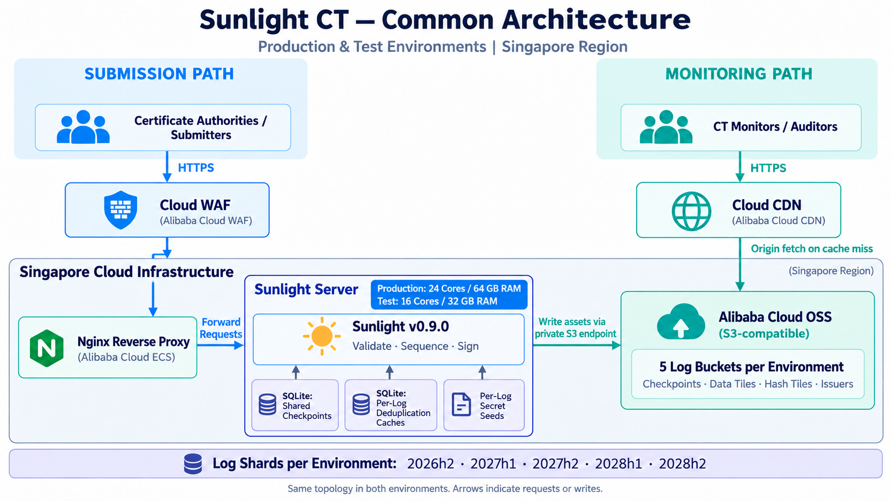

# Sunlight CT Environment Guide

English | [简体中文](readme_cn.md)

This document describes the existing deployment based on the provided test and production `sunlight.yaml` files and deployment details. Configuration files are stored separately for each environment. The remote services have not been verified at runtime as part of this documentation work.

S3 endpoint hostnames have been redacted as `https://s3-endpoint.example.invalid`. Replace this placeholder with the actual endpoint before deployment.

## 1. Project and Deployment Overview

- Project: [FiloSottile/sunlight](https://github.com/FiloSottile/sunlight)
- Version: recorded as `sunlight-0.9.0` based on the provided server directory name; the running binary version has not been verified.
- Region: both production and test environments are in Singapore.
- Production Sunlight server: 24 CPU cores and 64 GB RAM.
- Test Sunlight server: 16 CPU cores and 32 GB RAM.
- Both environments use the same architecture: WAF → Nginx → Sunlight, and CDN → OSS.
- Local storage: a SQLite checkpoint database, a separate SQLite deduplication cache for each log, and per-log secret seed files.
- Log data storage: Alibaba Cloud OSS, accessed through its S3-compatible API.
- Submission path: certificate submitters → cloud WAF → Nginx → Sunlight.
- Read path: monitoring clients → cloud CDN → OSS; cache hits are served directly by the CDN.

The test and production environments have the same topology. Whether Nginx and Sunlight run on the same host, and where TLS terminates along each hop, have not been confirmed.

## 2. Common Architecture

Both environments use the same architecture and are deployed in Singapore. The diagram below represents the topology of each environment, with its respective servers, logs, and configuration.

- Production Sunlight server: **24 CPU cores / 64 GB RAM**.
- Test Sunlight server: **16 CPU cores / 32 GB RAM**.

The diagram contains no IP addresses or domain names. Arrows indicate requests or writes; responses return along the same path.



## 3. Log Shard Configuration

| Shard | Test Log / Bucket | Production Log / Bucket | `notafterstart` | `notafterlimit` |
| --- | --- | --- | --- | --- |
| 2026h2 | `ct-test-2026h2` | `ct-2026h2` | `2026-07-01T00:00:00Z` | `2027-01-01T00:00:00Z` |
| 2027h1 | `ct-test-2027h1` | `ct-2027h1` | `2027-01-01T00:00:00Z` | `2027-07-01T00:00:00Z` |
| 2027h2 | `ct-test-2027h2` | `ct-2027h2` | `2027-07-01T00:00:00Z` | `2028-01-01T00:00:00Z` |
| 2028h1 | `ct-test-2028h1` | `ct-2028h1` | `2028-01-01T00:00:00Z` | `2028-07-01T00:00:00Z` |
| 2028h2 | `ct-test-2028h2` | `ct-2028h2` | `2028-07-01T00:00:00Z` | `2029-01-01T00:00:00Z` |

## 4. Complete Test Configuration

Configuration file: [sunlight-testing.yaml](config/sunlight-testing.yaml).

```yaml
listen:
  - "10.43.1.117:8080"
    #  - "[240b:4000:92:fd00:37a9:37af:feb1:a3ae]:8080"
    #acme:
    #hosts:
    #- ct-test.sunlight.sheca.com
    #cache: /var/db/sunlight/autocert-staging/
checkpoints: /tank/shared/checkpoints.db
logs:
  - shortname: ct-test-2026h2
    inception: 2026-09-01
    period: 200
    submissionprefix: https://ct-test-2026h2-sunlight.sheca.com
    monitoringprefix: https://ct-test-2026h2-bucket.sheca.com
    ccadbroots: testing
    extraroots: /etc/sunlight/extra-roots-staging.pem
    secret: /tank/enc/sheca2026h2.seed.bin
    cache: /tank/caches/ct-test-2026h2/cache.db
    poolsize: 750
    s3region: ap-southeast-1
    s3bucket: ct-test-2026h2
    s3endpoint: https://s3-endpoint.example.invalid
    notafterstart: 2026-07-01T00:00:00Z
    notafterlimit: 2027-01-01T00:00:00Z

  - shortname: ct-test-2027h1
    inception: 2026-09-01
    period: 200
    submissionprefix: https://ct-test-2027h1-sunlight.sheca.com
    monitoringprefix: https://ct-test-2027h1-bucket.sheca.com
    ccadbroots: testing
    extraroots: /etc/sunlight/extra-roots-staging.pem
    secret: /tank/enc/sheca2027h1.seed.bin
    cache: /tank/caches/ct-test-2027h1/cache.db
    poolsize: 750
    s3region: ap-southeast-1
    s3bucket: ct-test-2027h1
    s3endpoint: https://s3-endpoint.example.invalid
    notafterstart: 2027-01-01T00:00:00Z
    notafterlimit: 2027-07-01T00:00:00Z

  - shortname: ct-test-2027h2
    inception: 2026-09-01
    period: 200
    submissionprefix: https://ct-test-2027h2-sunlight.sheca.com
    monitoringprefix: https://ct-test-2027h2-bucket.sheca.com
    ccadbroots: testing
    extraroots: /etc/sunlight/extra-roots-staging.pem
    secret: /tank/enc/sheca2027h2.seed.bin
    cache: /tank/caches/ct-test-2027h2/cache.db
    poolsize: 750
    s3region: ap-southeast-1
    s3bucket: ct-test-2027h2
    s3endpoint: https://s3-endpoint.example.invalid
    notafterstart: 2027-07-01T00:00:00Z
    notafterlimit: 2028-01-01T00:00:00Z

  - shortname: ct-test-2028h1
    inception: 2026-09-01
    period: 200
    submissionprefix: https://ct-test-2028h1-sunlight.sheca.com
    monitoringprefix: https://ct-test-2028h1-bucket.sheca.com
    ccadbroots: testing
    extraroots: /etc/sunlight/extra-roots-staging.pem
    secret: /tank/enc/sheca2028h1.seed.bin
    cache: /tank/caches/ct-test-2028h1/cache.db
    poolsize: 750
    s3region: ap-southeast-1
    s3bucket: ct-test-2028h1
    s3endpoint: https://s3-endpoint.example.invalid
    notafterstart: 2028-01-01T00:00:00Z
    notafterlimit: 2028-07-01T00:00:00Z

  - shortname: ct-test-2028h2
    inception: 2026-09-01
    period: 200
    submissionprefix: https://ct-test-2028h2-sunlight.sheca.com
    monitoringprefix: https://ct-test-2028h2-bucket.sheca.com
    ccadbroots: testing
    extraroots: /etc/sunlight/extra-roots-staging.pem
    secret: /tank/enc/sheca2028h2.seed.bin
    cache: /tank/caches/ct-test-2028h2/cache.db
    poolsize: 750
    s3region: ap-southeast-1
    s3bucket: ct-test-2028h2
    s3endpoint: https://s3-endpoint.example.invalid
    notafterstart: 2028-07-01T00:00:00Z
    notafterlimit: 2029-01-01T00:00:00Z
```

## 5. Complete Production Configuration

Configuration file: [sunlight-production.yaml](config/sunlight-production.yaml).

```yaml
listen:
  - "10.43.1.117:8080"
    #  - "[240b:4000:92:fd00:37a9:37af:feb1:a3ae]:8080"
    #acme:
    #hosts:
    #- ct-test.sunlight.sheca.com
    #cache: /var/db/sunlight/autocert-staging/
checkpoints: /tank/shared/checkpoints.db
logs:
  - shortname: ct-2026h2
    inception: 2026-09-15
    period: 200
    submissionprefix: https://ct-2026h2-sunlight.sheca.com
    monitoringprefix: https://ct-2026h2-bucket.sheca.com
    ccadbroots: trusted
    secret: /tank/enc/sheca2026h2.seed.bin
    cache: /tank/caches/ct-2026h2/cache.db
    poolsize: 750
    s3region: ap-southeast-1
    s3bucket: ct-2026h2
    s3endpoint: https://s3-endpoint.example.invalid
    notafterstart: 2026-07-01T00:00:00Z
    notafterlimit: 2027-01-01T00:00:00Z

  - shortname: ct-2027h1
    inception: 2026-09-15
    period: 200
    submissionprefix: https://ct-2027h1-sunlight.sheca.com
    monitoringprefix: https://ct-2027h1-bucket.sheca.com
    ccadbroots: trusted
    secret: /tank/enc/sheca2027h1.seed.bin
    cache: /tank/caches/ct-2027h1/cache.db
    poolsize: 750
    s3region: ap-southeast-1
    s3bucket: ct-2027h1
    s3endpoint: https://s3-endpoint.example.invalid
    notafterstart: 2027-01-01T00:00:00Z
    notafterlimit: 2027-07-01T00:00:00Z

  - shortname: ct-2027h2
    inception: 2026-09-15
    period: 200
    submissionprefix: https://ct-2027h2-sunlight.sheca.com
    monitoringprefix: https://ct-2027h2-bucket.sheca.com
    ccadbroots: trusted
    secret: /tank/enc/sheca2027h2.seed.bin
    cache: /tank/caches/ct-2027h2/cache.db
    poolsize: 750
    s3region: ap-southeast-1
    s3bucket: ct-2027h2
    s3endpoint: https://s3-endpoint.example.invalid
    notafterstart: 2027-07-01T00:00:00Z
    notafterlimit: 2028-01-01T00:00:00Z

  - shortname: ct-2028h1
    inception: 2026-09-15
    period: 200
    submissionprefix: https://ct-2028h1-sunlight.sheca.com
    monitoringprefix: https://ct-2028h1-bucket.sheca.com
    ccadbroots: trusted
    secret: /tank/enc/sheca2028h1.seed.bin
    cache: /tank/caches/ct-2028h1/cache.db
    poolsize: 750
    s3region: ap-southeast-1
    s3bucket: ct-2028h1
    s3endpoint: https://s3-endpoint.example.invalid
    notafterstart: 2028-01-01T00:00:00Z
    notafterlimit: 2028-07-01T00:00:00Z

  - shortname: ct-2028h2
    inception: 2026-09-15
    period: 200
    submissionprefix: https://ct-2028h2-sunlight.sheca.com
    monitoringprefix: https://ct-2028h2-bucket.sheca.com
    ccadbroots: trusted
    secret: /tank/enc/sheca2028h2.seed.bin
    cache: /tank/caches/ct-2028h2/cache.db
    poolsize: 750
    s3region: ap-southeast-1
    s3bucket: ct-2028h2
    s3endpoint: https://s3-endpoint.example.invalid
    notafterstart: 2028-07-01T00:00:00Z
    notafterlimit: 2029-01-01T00:00:00Z
```
